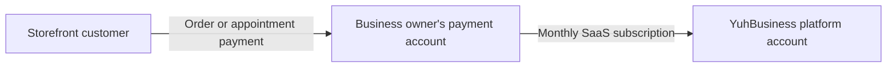

# YuhBusiness Product and Payment Overview

**Status date:** October 7, 2026

YuhBusiness is a multi-tenant software-as-a-service platform for Belizean and other local businesses that need a professional online storefront without building a separate website and management system. It supports appointment businesses, food and ordering businesses, and retail stores from one platform.

Each business receives its own storefront, dashboard, data, team access, subscription, settings, and customer activity. Customers use the public storefront to book services or place orders. Business owners and authorized staff use the private dashboard to manage daily operations. The YuhBusiness platform owner uses a separate, protected administration area to manage the SaaS platform.

## What the SaaS system does

YuhBusiness combines three products in one system:

1. **A public storefront** where customers can discover a business, view its products or services, contact it, book appointments, and place orders.
2. **A business operations dashboard** where owners and staff manage appointments, orders, products, services, customers, promotions, analytics, storefront settings, team access, and subscriptions.
3. **A platform administration system** where the YuhBusiness owner manages tenants, users, subscriptions, billing records, privacy requests, activity, and platform-level oversight.

The platform is multi-tenant. Every record is associated with a business tenant, and database row-level security helps prevent one business from accessing another business's records.

## Supported business types

### Appointment businesses

Suitable for salons, barbershops, clinics, studios, consultants, and other service providers. These businesses can publish services, accept appointment requests, manage provider availability, collect customer details, apply promotions, configure deposits, and track appointments through completion.

### Ordering businesses

Suitable for restaurants, bakeries, food trucks, cafés, and similar businesses. These businesses can publish menus, accept dine-in, pickup, and delivery orders, configure preparation times and delivery areas, manage order status, and apply taxes, fees, minimums, and discounts.

### Retail businesses

Suitable for clothing, footwear, gift, accessory, and other product-based stores. These businesses can publish products, track inventory, configure categories, product sizes, colors, variants, SKUs, price overrides, and promotions, and accept customer orders.

## User roles

### Storefront customers

Customers do not need a business dashboard account. They can browse public storefronts, select products or services, provide fulfilment and contact information, apply eligible promotion codes, submit orders or appointment requests, and receive confirmations.

### Business owners and staff

Business owners control the business account, storefront, operations, team, subscription, and billing. Managers and staff receive tenant-scoped access according to their assigned role and the business's plan limits.

### YuhBusiness platform owner

The platform owner uses the server-protected Super Admin area for platform operations. This role is separate from business-owner roles and is checked on the server before administration pages are rendered.

## Features working now

### Registration and account access

- Business-owner registration with account, business type, business details, storefront slug, and optional logo.
- Required acceptance of the Terms of Service and Privacy Policy, with version and acceptance-time records.
- Email confirmation, secure sign-in, sign-out, password recovery, and password reset through Supabase Auth.
- Protected dashboard routes with refreshed cookie-based sessions.
- One user can own or access multiple businesses and switch between them without creating a separate login.
- Each newly created business receives an independent 14-day trial, plan, subscription state, storefront, modules, and tenant membership.
- Account switching requires fresh credentials and preserves the separation between businesses.

### Public storefronts

- Public storefront pages based on a business-specific slug.
- Separate storefront experiences for appointments, ordering, and retail.
- Business logo, cover image, cover positioning and zoom, description, contact information, hours, social links, and brand colors.
- Product and service categories, images, prices, descriptions, and availability.
- Public promotions and discount-code discovery when the business enables them.
- Customer contact form for eligible plans.
- Published customer reviews filtered to show only approved public records.
- Storefront QR-code generation and download for printed or digital promotion.
- Search-engine metadata, canonical URLs, storefront sitemaps, storefront robots routes, and inactive-storefront 404 behavior.
- Installable progressive web app support with mobile-safe layouts and offline recovery behavior.

### Appointment booking

- Public service selection, date and time selection, and customer contact collection.
- Provider selection when a business configures multiple service providers.
- Provider-specific services, public profiles, schedules, and availability checks.
- Prevention of conflicting appointment times through server and database validation.
- Optional notes and customer concerns.
- Fixed or percentage service deposits as a configurable service rule.
- Promotion-code validation and server-calculated discounts.
- Pay-at-appointment booking submissions.
- Simulated card-payment records for development and workflow testing.
- Dashboard appointment search, filters, pagination, details, payment status, and status changes.
- Confirmation, completion, cancellation, and operational history.
- Configurable reminder schedules and reminder-delivery tracking. Actual delivery depends on the configured email or messaging provider.

### Ordering and retail checkout

- Shopping cart with quantity controls, variants, add-ons, and inventory-aware limits.
- Dine-in, pickup, and delivery order types.
- Requested fulfilment time, delivery address, delivery area, delivery instructions, table number, and order notes.
- Business-configured tax rate, minimum order, delivery fee, preparation time, opening and closing times, and delivery areas.
- Optional automatic threshold discounts controlled by the business owner.
- Promotion codes with percentage or fixed discounts, start and end dates, usage limits, and product applicability.
- Server-authoritative pricing. The server recalculates products, variants, add-ons, tax, discounts, fees, minimums, and inventory rather than trusting totals submitted by the browser.
- Atomic order creation, stock reduction, promotion redemption, and payment-status recording.
- Pay-at-business or pay-on-delivery order submission.
- Simulated card-payment records for development and workflow testing.
- Dashboard order search, filters, pagination, order details, payment status, and fulfilment-status updates.

### Product and service management

- Create, edit, activate, deactivate, and remove products and services.
- Category creation and ordering.
- Product stock counts and availability controls.
- Product add-ons with separate prices.
- Retail product sizes, colors, variants, SKUs, variant stock, and price overrides.
- Service price, duration, description, image, category, and deposit rules.
- Plan-controlled access to advanced catalog, product variant, and deposit features.

### Customer management

- Tenant-scoped customer directory built from business activity and customer records.
- Customer search and paginated lists.
- Add and edit customer contact details and internal notes.
- Customer activity, spending, order, and appointment history.
- Customer records remain isolated to the business that collected them.

### Dashboard and analytics

- Business overview with current operational totals and recent activity.
- Appointment or order metrics appropriate to the business type.
- Completed or delivered value, activity count, unique customers, average value, trends, and status breakdowns.
- Plan usage banners and monthly activity-limit enforcement.
- Detailed analytics restricted to plans that include the feature.

### Team and access management

- Owner-controlled Team and Access area.
- Fixed Owner, Manager, and Staff roles with tenant-scoped access.
- Email-bound, single-use, expiring invitations.
- Secure invitation links that owners can copy and send.
- Active member, pending invitation, seat allowance, and audit-history views.
- Role changes, member removal or deactivation, and preserved membership history.
- Database-enforced staff limits for each plan.
- Pending invitations reserve capacity but do not create a paid charge by themselves.
- Subscription seat quantity cannot be reduced below the number of active staff requiring seats.

### Business tools

- Service-provider profiles and weekly availability for appointment businesses.
- Service departments and service organization.
- Promotion and discount-code creation, editing, activation, scheduling, limits, and usage counts.
- Appointment-reminder rules and recent reminder status.
- Locally generated storefront QR codes.
- In-app notifications with recipient-specific read state and real-time updates.

### Business settings

- Business name, description, phone, email, address, and city.
- Weekly business hours.
- Storefront slug, logo, cover image, framing, brand colors, social links, and domain prefix controls according to plan.
- Ordering enablement, temporary pause, available order types, taxes, minimums, fees, discounts, timing, and delivery configuration.
- Subscription plan selection, seat totals, subscription status, current period, cancellation at period end, and billing history.

### Subscription and plan controls

| Plan       | Monthly price | Activity allowance                    | Team allowance                                                     |
| ---------- | ------------: | ------------------------------------- | ------------------------------------------------------------------ |
| Beginner   |        $9 BZD | Up to 50 orders or bookings per month | Owner only                                                         |
| Pro        |       $12 BZD | Up to 150 monthly activities          | Owner plus 1 included staff member; up to 3 additional paid seats  |
| Enterprise |       $15 BZD | Unlimited activity                    | Owner plus 2 included staff members; up to 7 additional paid seats |

Additional authorized staff seats cost $2 BZD each per month. Each business has its own subscription, even when one owner operates multiple businesses.

The subscription system currently includes:

- A 14-day trial with access to premium workflows for evaluation.
- Server-controlled plan prices and staff-seat calculations.
- Tenant-scoped subscription state and access enforcement.
- Current billing-period and cancellation-at-period-end behavior.
- Subscription invoices and a provider-neutral payment ledger.
- Idempotency protection against duplicate checkout completion.
- Development-only mock subscription completion through the provider abstraction.
- Production rejection of mock billing.

### Notifications and transactional email

- Durable database queues for order, appointment, account, business, contact, billing, and important alert emails.
- Responsive branded email templates.
- Recipient and tenant revalidation before delivery.
- Retry tracking, stale-job recovery, safe logging, and duplicate-delivery protection.
- Recipient-scoped real-time in-app notifications.
- Resend transport when valid server credentials and a permitted sender are configured.
- Supabase Auth email for account confirmation and password recovery when SMTP and redirect settings are configured.

### Platform administration

- Server-protected Super Admin area that fails closed when authentication or authorization cannot be verified.
- Platform overview, tenant management, tenant details, system analytics, activity records, billing records, and integration status.
- Tenant creation and guarded tenant deletion.
- Tenant-level staff or administrator creation through protected APIs.
- Account and tenant deletion safeguards, including protection for the active administrator and last business owner.
- Subscription administration for business tenants.
- Privacy-request queue with identity-verification status, target dates, resolution notes, and event history.
- Read-only access-oversight views where persistent role editing is not yet implemented.

### Security, privacy, and reliability

- Supabase row-level security and tenant membership checks.
- Server-only use of service-role credentials.
- Server authorization for billing, administration, and protected mutations.
- Origin validation, bounded request bodies, UUID validation, and distributed rate limiting on public mutation routes.
- Hashed rate-limit identities rather than raw identifiers.
- Database functions that prevent anonymous callers from bypassing protected APIs.
- Public Privacy Policy and Terms of Service.
- Public privacy-request form with reference codes and acknowledgements.
- Documented privacy operations, retention, incident-response, and legal-readiness procedures.
- No indexing of private dashboard and administration routes.
- Error, loading, not-found, service-worker, and offline-recovery surfaces.

## Current payment functionality

Real-money payments are not enabled. The application currently provides the payment screens, business rules, database records, and safe testing paths needed to integrate an authorized provider without pretending that real funds have moved.

### Customer payments that work today

- Customers can place orders using **pay at business**, **pay on delivery**, or the equivalent unpaid workflow.
- Customers can book appointments using **pay at appointment**.
- The server records these transactions as unpaid and the business can manage fulfilment through its dashboard.
- Development mock-card modes can create simulated paid records for order and appointment workflow testing where exposed by the current flow.
- Mock payments carry an explicit simulated-payment notice and do not collect payment credentials or move money.
- The customer online-payment checkout design supports DigiWallet and card presentation, order summaries, promotions, and totals, but its final online-payment action currently shows a coming-soon notice rather than charging the customer.

### Business subscription payments that work today

- The Billing and Payments area calculates the selected plan and paid-seat total.
- It displays subscription status, period dates, cancellation state, invoices, and payment-ledger records.
- Owners can schedule subscription cancellation at the end of the current paid period.
- The server has a provider-neutral subscription checkout API and a development mock provider.
- Mock subscription processing is rejected automatically in production.
- The visible DigiWallet and card payment form is currently a preview. Its Continue button does not charge the business owner until a real provider adapter is installed and connected.

## Upcoming real payment feature

The real payment implementation will preserve two separate payment relationships.

### Customer pays the business owner

The customer checkout on a business's storefront will charge the customer for that business's order or appointment. The payment provider will route or settle the funds to the payment account associated with that specific business.

YuhBusiness will provide the storefront and transaction workflow, but customer-sale funds must not be confused with the business owner's YuhBusiness subscription. The intended flow is:

1. The customer chooses DigiWallet or card at storefront checkout.
2. The authorized payment provider securely collects the customer's payment credentials.
3. YuhBusiness sends the provider the server-verified amount and the correct business payment-account reference.
4. The provider authorizes the payment and settles it to the business owner according to its terms.
5. A verified webhook updates the YuhBusiness order or appointment, payment status, reference, fee, refund, or dispute record.

### Business owner pays YuhBusiness

The Payment Method area inside **Dashboard → Settings → Billing and Payments** will remain exclusively for the business owner's YuhBusiness subscription.

The intended flow is:

1. The owner selects a plan and any additional paid staff seats.
2. The server calculates the official recurring BZD amount.
3. The authorized payment provider charges the business owner.
4. Funds settle to the YuhBusiness platform account.
5. A verified webhook activates or renews that business's subscription and records the invoice and payment transaction.

### Work required before launch

The following items are not yet live and are required before real money can be accepted:

- Select an appropriately authorized provider that supports the intended Belize payment methods and settlement model.
- Install separate provider adapters for customer transactions and SaaS subscription billing where required.
- Associate each business with the provider-side account or settlement reference used for its customer payments.
- Replace preview card inputs with provider-hosted or tokenized payment fields so raw credentials never pass through YuhBusiness servers.
- Add sandbox and production credentials through server-only environment variables.
- Implement signed and replay-safe webhooks for authorization, capture, failure, settlement, refund, chargeback, dispute, renewal, and cancellation events.
- Preserve server-authoritative amounts, tenant checks, idempotency, audit records, and safe retry behavior.
- Add business-facing refund and dispute procedures supported by the chosen provider.
- Publish provider name, fees, settlement times, supported methods, refund rules, dispute rules, and provider privacy terms.
- Complete sandbox, failure-path, webhook, reconciliation, and production-readiness testing.
- Obtain Belize-qualified legal and regulatory review before activation.

## Customer information and payment-data boundaries

YuhBusiness stores the operational customer information needed to create and fulfil an order or appointment. Depending on the transaction, this can include the customer's name, email, phone number, products or services, appointment time, delivery or pickup information, notes, discounts, totals, status, and provider transaction reference.

The relevant business owner and authorized staff can access that business's customer and transaction records. The platform operator has controlled technical and administrative access where necessary for support, security, privacy requests, fraud investigation, and legal obligations. Access should be limited, logged, and used only for legitimate platform operations.

YuhBusiness should not collect or store raw card numbers, CVVs, bank-login credentials, DigiWallet passwords, or wallet PINs. The authorized payment provider should handle those credentials. YuhBusiness should retain only the information needed for operations and reconciliation, such as amount, currency, status, provider reference, timestamps, fees, refunds, disputes, and masked payment-method details when supplied safely by the provider.

## Configuration-dependent features

Some implemented features require external services or production configuration before they operate outside development:

- Supabase project, database migrations, authentication URLs, storage, and row-level-security policies.
- Resend credentials and a verified sender domain for unrestricted transactional email.
- Supabase Auth SMTP for production confirmation, invitation, and password-reset email.
- Scheduled invocation of the email and reminder workers.
- Production domain and DNS configuration.
- A real payment provider, credentials, adapters, merchant setup, and verified webhooks.

## Current limitations

- Online DigiWallet and card screens are previews and do not process real money.
- Payment-provider account onboarding and real settlement are not implemented.
- Refunds, chargebacks, disputes, and settlement reconciliation are not connected to a live provider.
- Appointment reminder rows can be scheduled and tracked, but delivery requires a configured email or messaging provider.
- Some standalone administration role screens remain read-only or use temporary display data while persistent role management is completed.
- Production readiness still requires operational configuration, payment-provider integration, legal review, and end-to-end verification in the deployed environment.
